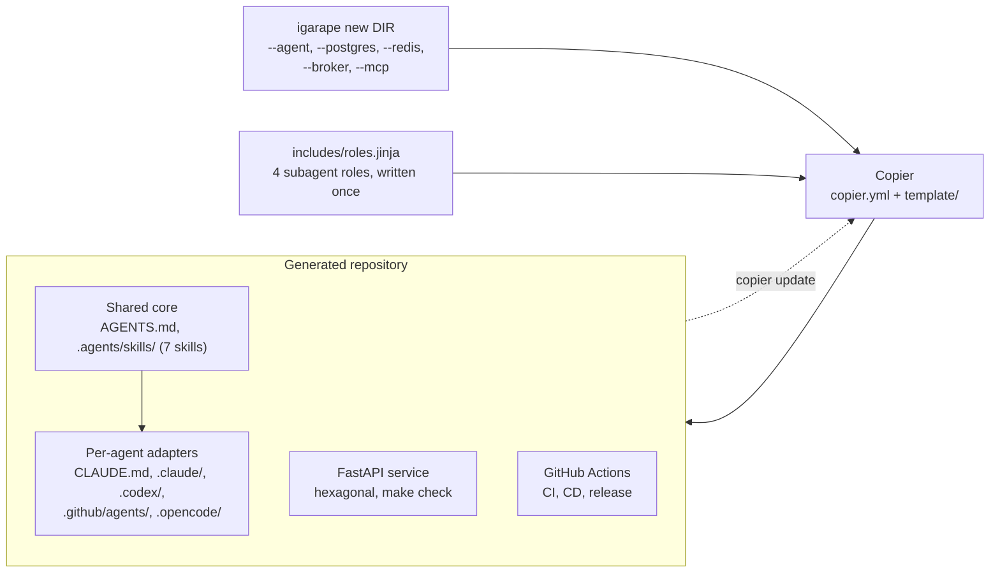

<p align="center">
  
</p>

<p align="center">
  <a href="https://github.com/spassos/igarape/actions/workflows/template-ci.yml"></a>
  <a href="https://scorecard.dev/viewer/?uri=github.com/spassos/igarape"></a>
  <a href="https://pypi.org/project/igarape/"></a>
  <a href="LICENSE"></a>
  <a href="copier.yml"></a>
  <br>
  <a href="#agent-support"></a>
  <a href="https://copier.readthedocs.io/"></a>
  <a href="https://docs.astral.sh/uv/"></a>
  <a href="https://docs.astral.sh/ruff/"></a>
  <a href="https://mypy.readthedocs.io/en/stable/command_line.html#cmdoption-mypy-strict"></a>
  <a href="https://www.conventionalcommits.org/en/v1.0.0/"></a>
</p>

# Igarapé

**Igarapé** is a CLI that generates Python service repositories ready for coding agents.
Scaffold a FastAPI repository with shared agent guidance, automated checks and optional delivery workflows.

> Igarapé is in early development and available on [PyPI](https://pypi.org/project/igarape/).
> See the [roadmap](#roadmap).

## Why Igarapé

Coding agents write code fast. Without a shared process they also ship unspecified behavior,
untested requirements and unreviewed security, and every team configures its agent differently.

Igarapé is a **golden path for Python services built with coding agents**: one command creates a
production-ready repository where the process, the quality bar and the delivery pipeline are
already in place, whichever agent the team uses.

| What you get | How it is enforced |
|---|---|
| **One SDLC for every agent.** Six phases (Discovery → Specify → Plan → Implement → Review → Ship), each a skill that produces a versioned artifact and ends at a gate: human approval of the PRD, spec, plan and merge; a green `make check` and no blocking review findings in between. `AGENTS.md`, seven skills (`discovery`, `specify`, `plan`, `implement`, `integrate`, `review`, `ship`) and four subagent roles (`architect`, `test_engineer`, `reviewer`, `security_auditor`). | The same `AGENTS.md` and `.agents/skills/` are read by Codex, Claude Code, GitHub Copilot and OpenCode; each agent gets only a thin adapter generated from the same source, and the subagents are read-only except `test_engineer`. |
| **A real service, not a blank repo.** FastAPI with hexagonal architecture, in memory by default. PostgreSQL (SQLAlchemy async + Alembic), Redis and Kafka or RabbitMQ (FastStream publisher + consumer worker) are opt-in. An outbound HTTP client with timeouts and retries is always included. | import-linter keeps the layers apart (`domain` and `application` import no framework); integrations are generated only when chosen, with no dead code. |
| **Quality gates the agent cannot talk its way around.** | `make check` runs Ruff (PEP 8/257 and Bandit rules), `mypy --strict`, import-linter, pip-audit on the locked tree and pytest with branch coverage ≥ 90%. The same checks run on a laptop, in an agent session and in CI. Tests cover unit, API and integration (testcontainers) levels, plus a migration round-trip. |
| **Security by default.** OWASP API Security Top 10 controls: versioned `/v1` routes, generic JWT/OIDC authentication (JWKS, scopes, deny by default), object-level authorization (another owner's item returns 404), RFC 9457 problem details, security headers, a request-body size limit, `/docs` disabled in production and an SSRF guard for outbound HTTP. The mapping lives in the generated docs. | Security, contract (Schemathesis) and property (Hypothesis) tests ship with the service. CI runs gitleaks, zizmor and Trivy, with actions pinned by commit SHA and least-privilege permissions. |
| **Delivery verified in production (optional).** Opt-in CD (`ENABLE_CD=true`) pushes an image to GHCR with build-provenance attestation, deploys to staging, runs an OWASP ZAP baseline scan there, then deploys to production behind an environment approval. Opt-in release-please (`ENABLE_RELEASES=true`) keeps a release PR with the next semantic version and CHANGELOG; merging it tags `vX.Y.Z`, publishes the GitHub release and, with CD, ships that version. | A deploy is done only when the smoke test confirms the deployed version (the release version, else the commit SHA) and readiness; otherwise it rolls back automatically. PR titles must follow Conventional Commits. |
| **Projects keep improving.** | Generated repositories stay linked to the template; `copier update` brings later improvements. |

Igarapé does not replace your coding agent or invent new tooling. It combines established tools
(uv, Ruff, mypy, pytest, FastAPI, SQLAlchemy, FastStream, Copier, GitHub Actions) into one lean,
agent-neutral path from idea to production.

## Quick start

Install Git and `make`. Docker is needed only for the optional integrations.

With [uv](https://docs.astral.sh/uv/):

```bash
uvx igarape new orders-api
cd orders-api
make dev
```

For pip, activate a virtual environment with Python 3.12 or newer.

```bash
python -m pip install --upgrade igarape
```

If your installed version is `0.2.0`, install `uv` separately with
`python -m pip install uv` in the same environment. Then generate the service:

```bash
igarape new orders-api
```

Then enter `orders-api` and run `make dev`. The in-memory API listens on
`http://127.0.0.1:8000`.

`make dev` is the one command for local work. It installs the dependencies into the project's
own `.venv`, creates `.env` with a local dev secret (so `make token` works) and runs the API with
reload. With `--postgres`, `--redis` or `--broker` it starts only those services in Docker and
runs the API on your machine; `make dev DOCKER=0` uses services you already run. The pip virtual
environment stays separate: keep it active when you run `make`, because `uv` comes from it, and
the project's tools never run in it. `igarape new` prints these next steps for the chosen profile.

Use `--agent` to choose your coding agent (repeatable); only its files are generated. Without it,
`igarape new` asks at a terminal and configures Codex otherwise.
Then open the directory with your coding agent. It reads `AGENTS.md` first.

## How it works

`igarape new` validates the options, renders the Copier template, locks the dependencies with
`uv lock`, initializes a Git repository and commits the scaffold. If the initial commit fails,
Igarapé keeps the scaffold and shows the Git error. The generated Claude Code settings allow
specific Git commands for inspection, staging and commits, with confirmation before pushing.
With CD and releases enabled, reruns keep the release version when its tag points to the same
commit. The agent guidance is written once in a shared core; each selected agent
gets only a thin adapter in the format it reads. Details:
[`docs/architecture.md`](docs/architecture.md).



## The agentic SDLC

Every generated project ships the same six-phase process as skills in `.agents/skills/`. Each
phase produces a versioned artifact and ends at a gate. A well-scoped local fix may start at
`implement` with a regression test.


Skills are written `$skill` (Codex syntax); in Claude Code they are `/skill`, and in Copilot and
OpenCode you ask for the skill by name. The seventh skill, `$integrate`, adds a new external
system as a port, adapter, in-memory fake and integration test.

## Agent support

`AGENTS.md`, the skills and the four roles are written once; each selected agent only gets the
adapter its format requires.

| Agent | Instructions | Skills | Subagents | MCP | PR review |
|---|---|---|---|---|---|
| Codex | `AGENTS.md` | `.agents/skills` | `.codex/agents/*.toml` | `.codex/config.toml` | `codex-review.yml` (opt-in) |
| Claude Code | `CLAUDE.md` → `@AGENTS.md` | `.claude/skills` (symlinks) | `.claude/agents/*.md` | `.mcp.json` | `claude-review.yml` (opt-in) |
| GitHub Copilot | `AGENTS.md` (+ pointer in `.github/copilot-instructions.md`) | `.agents/skills` | `.github/agents/*.agent.md` | `.vscode/mcp.json`, `.github/mcp.json` | Native code review |
| OpenCode (V2) | `AGENTS.md` | `.agents/skills` | `.opencode/agents/*.md` | `opencode.json` | — |

The Copilot cloud agent gets `copilot-setup-steps.yml` so it can run `make check`; its MCP servers
are configured in the repository settings.

## Why you can trust it

[Template CI](.github/workflows/template-ci.yml) runs on every pull request and every push to
`main`:

| Check | What it proves |
|---|---|
| `ruff check` + `ruff format --check` | The CLI and tests are clean. |
| `uv run pytest` | All 6 scenarios render with the expected layout; every agent adapter renders the shared roles with the right permissions; the CLI rejects invalid input without touching the destination; the CD, release, deploy and rollback policy behaves as documented; release-please bumps `pyproject.toml` and `uv.lock` together, here and in generated services. |
| `uv run pytest -m smoke` | The built wheel is installed with pip in a clean virtual environment. The resulting CLI generates the default service, which starts, becomes ready and creates and reads an item over HTTP. |
| zizmor | The workflows of a project generated with all four agents, and this repository's own, have no medium+ findings. |
| Property-based tests (Hypothesis) | The CLI's external input (`--mcp NAME=URL`) only accepts credential-free HTTPS endpoints, and nothing it accepts can break out of the generated TOML/JSON config. |
| Pinned base images | The generated `Dockerfile` pins both base images by digest for Python 3.12, 3.13 and 3.14. |
| `make check` × 6 scenarios | Each generated project passes its own gate: `all-agents`, `full-kafka`, `minimal`, `postgres-rabbit`, `redis-only`, `with-mcp`, with real PostgreSQL, Redis, Kafka and RabbitMQ in containers. |
| Generated images | The Dockerfile builds for the in-memory and full (Postgres + Redis + Kafka) profiles; the in-memory container starts and reports the build version; the full image packages its entrypoints and migrations; Trivy fails on fixable HIGH/CRITICAL CVEs. |

Repository controls: actions pinned by commit SHA, `permissions: {}` by default, checkout without
persisted credentials, Dependabot for actions and Python dependencies,
[CodeQL](.github/workflows/codeql.yml) static analysis of the Python code and workflows,
[OpenSSF Scorecard](.github/workflows/scorecard.yml), release-please releases (version, tag,
GitHub release and CHANGELOG from Conventional Commits) and PyPI publishing through trusted
publishing (OIDC) only after the release wheel generates and tests a service. See
[`SECURITY.md`](SECURITY.md).

## Usage

```bash
igarape new inventory --postgres --redis --broker rabbit
igarape new ai-service --agent claude --agent copilot --mcp docs=https://example.com/mcp
igarape --help
```

| Option | Default | Effect |
|---|---|---|
| `--agent` (repeatable) | `codex` | `claude`, `codex`, `copilot`, `opencode` |
| `--name` / `--description` / `--author` | derived | Project metadata |
| `--python` | `3.13` | `3.12`, `3.13` or `3.14` |
| `--postgres`, `--redis` | off | Optional integrations, tested against real containers |
| `--broker` | `none` | `kafka` or `rabbit` (publisher + consumer worker) |
| `--mcp NAME=URL` (repeatable) | none | Project MCP server (HTTPS, no credentials, query or fragment) |
| `--template` / `--ref` | upstream `main` | Use a local checkout or a specific revision |

Install it for repeated use with `uv tool install igarape`.
Generated projects record their template revision in `.copier-answers.yml`; run
`uvx copier update` inside one to bring later template improvements.

## Roadmap

1. **Portable core** — CLI, `--agent`, agent-neutral roles. ✅
2. **Adapters** — Codex, Claude Code, GitHub Copilot and OpenCode. ✅
3. **Images** — generated Dockerfiles built, smoke-tested and scanned in CI. ✅
4. **Drift check** — `make agents-check` so edits to one agent's files cannot silently diverge.
5. **Evidence** — pilot comparing agents with and without the guidance, on the same tasks.
6. **Release** — publish `igarape` on PyPI. ✅

## Contributing

Read [`CONTRIBUTING.md`](CONTRIBUTING.md) and [`AGENTS.md`](AGENTS.md) before changing the
template. In short: every scenario must pass `uv run pytest -m slow`, a new option needs a new
scenario, and workflows pin actions by SHA. Report vulnerabilities privately as described in
[`SECURITY.md`](SECURITY.md).

## License

[MIT](LICENSE)

## Why the name

*Igarapé* comes from Tupi: *igara* (canoe) + *pé* (path), "the canoe's path", the narrow
waterways that cross the Amazon forest. The process is the igarapé; every coding agent is an
*igara* travelling the same path to production.
