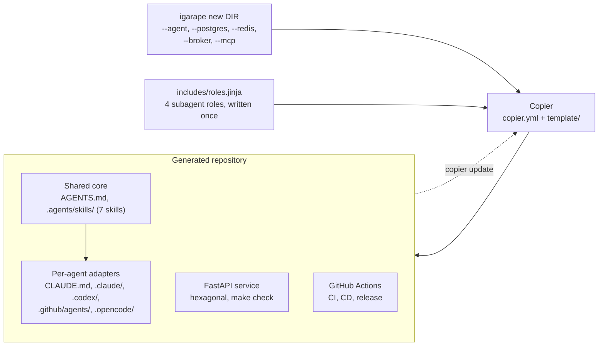
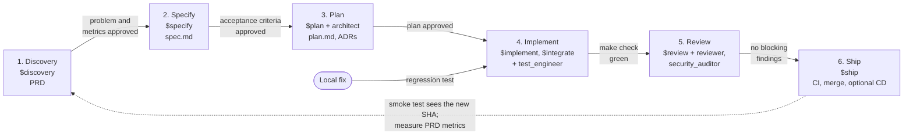

<p align="center">
  
</p>

<p align="center">
  <a href="https://github.com/spassos/igarape/actions/workflows/template-ci.yml"></a>
  <a href="https://scorecard.dev/viewer/?uri=github.com/spassos/igarape"></a>
  <!-- PyPI badge goes here once `igarape` is published (docs/pypi.md):
  <a href="https://pypi.org/project/igarape/"></a>
  -->
  <a href="LICENSE"></a>
  <a href="copier.yml"></a>
  <br>
  <a href="#agent-support"></a>
  <a href="https://copier.readthedocs.io/"></a>
  <a href="https://docs.astral.sh/uv/"></a>
  <a href="https://docs.astral.sh/ruff/"></a>
  <a href="https://mypy.readthedocs.io/en/stable/command_line.html#cmdoption-mypy-strict"></a>
  <a href="https://www.conventionalcommits.org/en/v1.0.0/"></a>
</p>

# Igarapé

**Igarapé** is a CLI that generates Python service repositories ready for coding agents. One
command gives you a FastAPI service, one development process written once for every agent
(Codex, Claude Code, GitHub Copilot, OpenCode), one quality gate (`make check`) and a CI/CD
pipeline that only calls a release done when the new version is verified live. Generated projects
stay connected to the template, so `copier update` brings later improvements.

> **Status:** early development, not yet on PyPI. Install from Git (below). See the
> [Roadmap](#roadmap).

## Quick start

Requirements: [uv](https://docs.astral.sh/uv/), Git and `make`. Docker is needed only for the
optional integrations.

```bash
uvx --from 'git+https://github.com/spassos/igarape.git@main' igarape new orders-api
cd orders-api && make bootstrap && make run   # in-memory API on http://127.0.0.1:8000
make check                                    # the Definition of Done gate
```

Then open the directory with your coding agent. It reads `AGENTS.md` first.

## How it works

`igarape new` validates the options, renders the Copier template, locks the dependencies with
`uv lock` and initializes a Git repository. The agent guidance is written once in a shared core;
each selected agent gets only a thin adapter in the format it reads. Details:
[`docs/architecture.md`](docs/architecture.md).



## The agentic SDLC

Every generated project ships the same six-phase process as skills in `.agents/skills/`. Each
phase produces a versioned artifact and ends at a gate. A well-scoped local fix may start at
`implement` with a regression test.



Skills are written `$skill` (Codex syntax); in Claude Code they are `/skill`, and in Copilot and
OpenCode you ask for the skill by name. The seventh skill, `$integrate`, adds a new external
system as a port, adapter, in-memory fake and integration test.

## What you get

- **Agent layer:** `AGENTS.md`, seven skills (`discovery`, `specify`, `plan`, `implement`,
  `integrate`, `review`, `ship`) and four subagent roles (`architect`, `test_engineer`, `reviewer`,
  `security_auditor`, read-only except `test_engineer`), defined once and rendered per agent.
- **Service:** FastAPI with hexagonal layers enforced by import-linter (`domain` and `application`
  import no framework). In memory by default; PostgreSQL (SQLAlchemy async + Alembic), Redis and
  Kafka or RabbitMQ (FastStream publisher + consumer worker) are opt-in. Versioned `/v1` routes,
  generic JWT/OIDC authentication (JWKS, scopes, deny by default), object-level authorization
  (another owner's item returns 404), RFC 9457 problem details, security headers, a request-body
  size limit, `/docs` disabled in production and an SSRF guard for outbound HTTP. The OWASP API
  Security Top 10 mapping lives in the generated docs.
- **One gate:** `make check` runs Ruff (PEP 8/257 and Bandit rules), mypy `--strict`,
  import-linter, pip-audit on the locked tree and pytest with branch coverage ≥ 90%. Tests cover
  unit, API, integration (testcontainers), Schemathesis contract tests, Hypothesis property tests
  and a migration round-trip. The same command serves people, agents and CI.
- **Delivery:** GitHub Actions with actions pinned by commit SHA and least-privilege permissions,
  gitleaks, zizmor, Trivy and a Conventional Commit PR title check. Opt-in CD (`ENABLE_CD=true`)
  pushes an image to GHCR with build-provenance attestation, deploys to staging, runs an OWASP ZAP
  baseline scan there, then production behind an environment approval. Each deploy is verified by
  a smoke test that sees the commit SHA live and rolls back automatically on failure. Opt-in
  release-please (`ENABLE_RELEASES=true`) keeps the CHANGELOG and semantic versions.

## Agent support

`AGENTS.md`, the skills and the four roles are written once; each selected agent only gets the
adapter its format requires.

| Agent | Instructions | Skills | Subagents | MCP | PR review |
|---|---|---|---|---|---|
| Codex | `AGENTS.md` | `.agents/skills` | `.codex/agents/*.toml` | `.codex/config.toml` | `codex-review.yml` (opt-in) |
| Claude Code | `CLAUDE.md` → `@AGENTS.md` | `.claude/skills` (symlinks) | `.claude/agents/*.md` | `.mcp.json` | `claude-review.yml` (opt-in) |
| GitHub Copilot | `AGENTS.md` (+ pointer in `.github/copilot-instructions.md`) | `.agents/skills` | `.github/agents/*.agent.md` | `.vscode/mcp.json`, `.github/mcp.json` | Native code review |
| OpenCode (V2) | `AGENTS.md` | `.agents/skills` | `.opencode/agents/*.md` | `opencode.json` | — |

The Copilot cloud agent gets `copilot-setup-steps.yml` so it can run `make check`; its MCP servers
are configured in the repository settings.

## Why you can trust it

[Template CI](.github/workflows/template-ci.yml) runs on every pull request and every push to
`main`:

| Check | What it proves |
|---|---|
| `ruff check` + `ruff format --check` | The CLI and tests are clean. |
| `uv run pytest` | All 6 scenarios render with the expected layout; every agent adapter renders the shared roles with the right permissions; the CLI rejects invalid input without touching the destination; the CD, deploy and rollback policy behaves as documented. |
| `uv run pytest -m smoke` | The built wheel generates the default service, which starts, becomes ready and creates and reads an item over HTTP. |
| zizmor | The workflows of a project generated with all four agents, and this repository's own, have no medium+ findings. |
| `make check` × 6 scenarios | Each generated project passes its own gate: `all-agents`, `full-kafka`, `minimal`, `postgres-rabbit`, `redis-only`, `with-mcp`, with real PostgreSQL, Redis, Kafka and RabbitMQ in containers. |
| Generated images | The Dockerfile builds for the in-memory and full (Postgres + Redis + Kafka) profiles; the in-memory container starts and reports the build version; the full image packages its entrypoints and migrations; Trivy fails on fixable HIGH/CRITICAL CVEs. |

Repository controls: actions pinned by commit SHA, `permissions: {}` by default, checkout without
persisted credentials, Dependabot for actions and Python dependencies,
[OpenSSF Scorecard](.github/workflows/scorecard.yml), and PyPI publishing through trusted
publishing (OIDC) only after the release wheel generates and tests a service. See
[`SECURITY.md`](SECURITY.md).

## Usage

```bash
igarape new inventory --postgres --redis --broker rabbit
igarape new ai-service --agent claude --agent copilot --mcp docs=https://example.com/mcp
igarape --help
```

| Option | Default | Effect |
|---|---|---|
| `--agent` (repeatable) | `codex` | `claude`, `codex`, `copilot`, `opencode` |
| `--name` / `--description` / `--author` | derived | Project metadata |
| `--python` | `3.13` | `3.12`, `3.13` or `3.14` |
| `--postgres`, `--redis` | off | Optional integrations, tested against real containers |
| `--broker` | `none` | `kafka` or `rabbit` (publisher + consumer worker) |
| `--mcp NAME=URL` (repeatable) | none | Project MCP server (HTTPS, no credentials, query or fragment) |
| `--template` / `--ref` | upstream `main` | Use a local checkout or a specific revision |

Install it for repeated use with `uv tool install git+https://github.com/spassos/igarape.git`.
Generated projects record their template revision in `.copier-answers.yml`; run
`uvx copier update` inside one to bring later template improvements.

## Roadmap

1. **Portable core** — CLI, `--agent`, agent-neutral roles. ✅
2. **Adapters** — Codex, Claude Code, GitHub Copilot and OpenCode. ✅
3. **Images** — generated Dockerfiles built, smoke-tested and scanned in CI. ✅
4. **Drift check** — `make agents-check` so edits to one agent's files cannot silently diverge.
5. **Evidence** — pilot comparing agents with and without the guidance, on the same tasks.
6. **Release** — publish `igarape` on PyPI.

## Contributing

Read [`CONTRIBUTING.md`](CONTRIBUTING.md) and [`AGENTS.md`](AGENTS.md) before changing the
template. In short: every scenario must pass `uv run pytest -m slow`, a new option needs a new
scenario, and workflows pin actions by SHA. Report vulnerabilities privately as described in
[`SECURITY.md`](SECURITY.md).

## License

[MIT](LICENSE)

## Why the name

*Igarapé* comes from Tupi: *igara* (canoe) + *pé* (path), "the canoe's path", the narrow
waterways that cross the Amazon forest. The process is the igarapé; every coding agent is an
*igara* travelling the same path to production.
