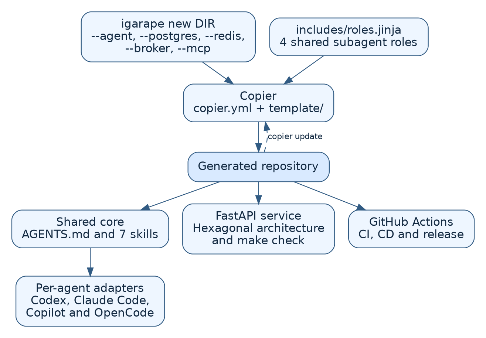
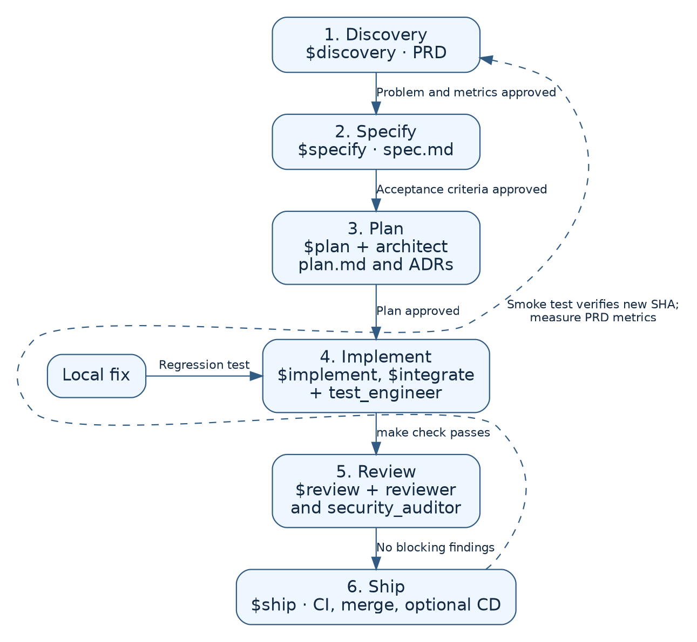

# Igarapé

Igarapé is a CLI that generates Python service repositories ready for Codex, Claude Code,
GitHub Copilot and OpenCode.

## Quick start

Install Git and `make`. Docker is needed for the optional integrations. If you already use
[uv](https://docs.astral.sh/uv/), run:

```bash
uvx igarape new orders-api
cd orders-api
make bootstrap
make run
```

To install with pip, activate a virtual environment, run `python -m pip install igarape`,
then run `igarape new orders-api`. The package installs uv into the same environment.

The default in-memory API starts at `http://127.0.0.1:8000`. Open the generated directory
with your coding agent and start with `AGENTS.md`. Run `make check` to check the service.

## How scaffolding works

`igarape new` uses Copier to generate a FastAPI service with hexagonal architecture, shared
agent guidance, per-agent adapters and GitHub Actions workflows. PostgreSQL, Redis and Kafka
or RabbitMQ are optional. Generated projects can receive template updates with `copier update`.



## The agentic SDLC

Each generated project includes skills for discovery, specification, planning, implementation,
review and delivery. Each phase produces an artifact and ends at a gate. A small fix can enter
at implementation with a regression test.



See the [project README](https://github.com/spassos/igarape#readme) for CLI options, agent
support and quality gates.
