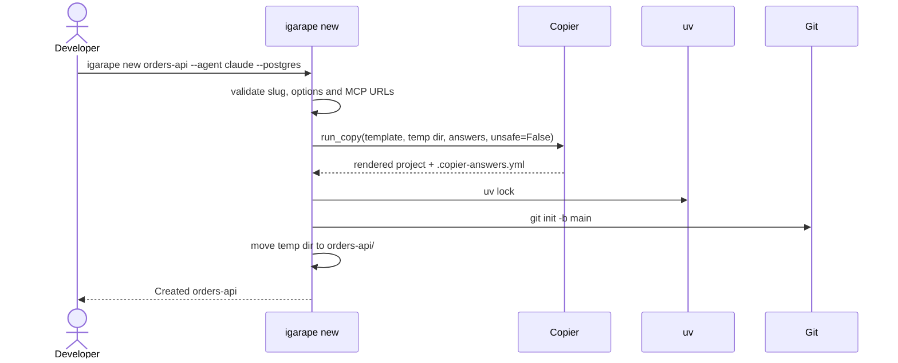
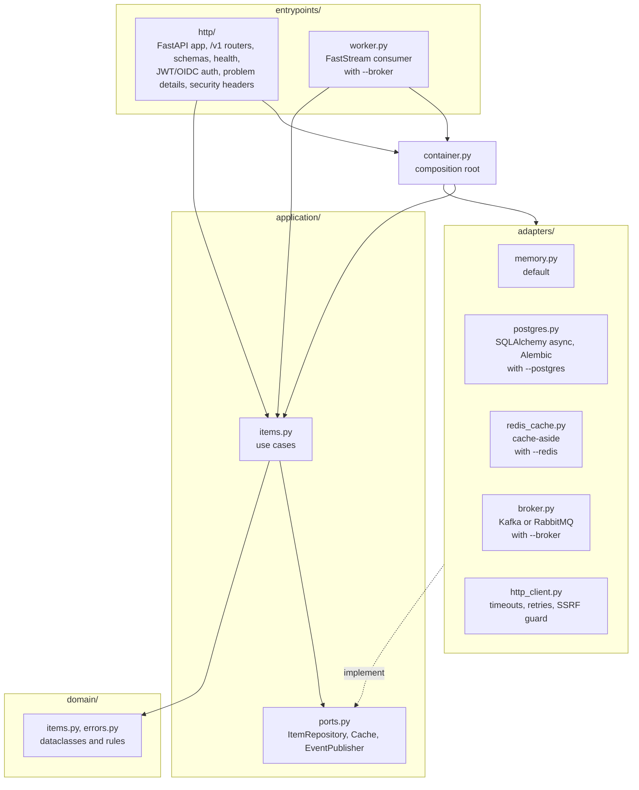
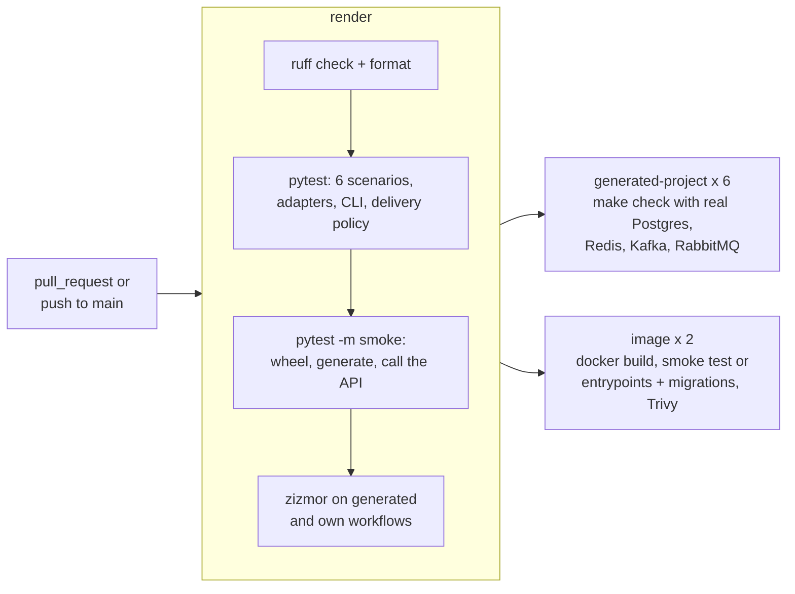
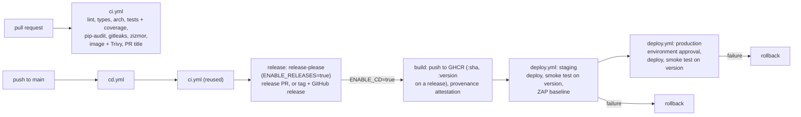

# Architecture

This document explains how the igarape template is built, what it generates and how both are
verified. For usage, see the [README](../README.md); for contribution rules, see
[`CONTRIBUTING.md`](../CONTRIBUTING.md).

## Repository layout

| Path | Role |
|---|---|
| [`src/igarape/cli.py`](../src/igarape/cli.py) | The `igarape` CLI: argument validation and the call to Copier. |
| [`copier.yml`](../copier.yml) | Template questions (`project_name`, `agents`, `use_postgres`, `use_redis`, `event_broker`, `mcp_servers`, `python_version`, `coverage_threshold`, …). |
| [`template/`](../template) | Everything rendered into a new project (`_subdirectory: template`). |
| [`includes/roles.jinja`](../includes/roles.jinja) | The single definition of the four subagent roles. |
| [`includes/opencode_agent.jinja`](../includes/opencode_agent.jinja) | Macro that renders one role as an OpenCode V2 agent file. |
| [`tests/`](../tests) | Render, smoke and slow (generated `make check`) tests. |
| [`.github/workflows/`](../.github/workflows) | Template CI, release and PyPI publishing, CodeQL and OpenSSF Scorecard. |

## How the template works

### CLI flow

`igarape new` is a thin wrapper around Copier. It derives the project slug from the directory
name, validates it as a Python package name, validates every `--mcp NAME=URL` (HTTPS, no
credentials, query or fragment, unique names) and refuses an existing destination. It renders into
a temporary directory next to the destination and only moves the result into place once
every step succeeded, so a failed run leaves no partial project behind.

Without `--template`, the CLI renders `https://github.com/spassos/igarape.git` at `main`; with
`--template PATH` it renders a local checkout at `HEAD` (or `--ref`). Copier runs with
`unsafe=False`, so Copier refuses to run template tasks, migrations or custom Jinja extensions
on the user's machine.

### Conditional files

Copier renders `*.jinja` files and evaluates Jinja in file and directory names. A name that
renders to an empty string is skipped, which is how options select files:

| Template path | Present when |
|---|---|
| `.claude/` | Claude Code is selected |
| `.codex/` | Codex is selected |
| `.github/agents/` | Copilot is selected |
| `.opencode/` | OpenCode is selected |
| `adapters/postgres.py.jinja`, `migrations/` | `--postgres` |
| `adapters/redis_cache.py.jinja` | `--redis` |
| `adapters/broker.py.jinja`, `entrypoints/worker.py` | `--broker kafka\|rabbit` |
| `.mcp.json`, `.vscode/mcp.json`, `.github/mcp.json`, `opencode.json` | the matching agent and at least one `--mcp` |

Inside files, the same answers switch dependencies (`pyproject.toml`), wiring (`container.py`),
Compose services, import-linter contracts and docs.

### One source for agent guidance

The guidance is written once and adapted per agent:

- `template/AGENTS.md.jinja` holds commands, workflow, architecture, conventions and guardrails.
  Codex, Copilot and OpenCode read it directly; Claude Code reads `CLAUDE.md`, which imports it
  with `@AGENTS.md`.
- `template/.agents/skills/` holds the seven SDLC skills. Claude Code's `.claude/skills/*` are
  symlinks to them (`_preserve_symlinks: true` in `copier.yml`), so there is no copy to drift.
- [`includes/roles.jinja`](../includes/roles.jinja) defines `architect`, `test_engineer`,
  `reviewer` and `security_auditor` (description, access level, instructions). Every agent file
  imports it and only adds the format and permission model of that agent:

| Agent | Rendered file | Read-only roles get |
|---|---|---|
| Codex | `.codex/agents/<role>.toml` | `sandbox_mode = "read-only"` |
| Claude Code | `.claude/agents/<role-with-hyphens>.md` | `disallowedTools: Edit, Write, NotebookEdit` |
| GitHub Copilot | `.github/agents/<role>.agent.md` | `tools` without `edit` |
| OpenCode V2 | `.opencode/agents/<role>.md` | `edit` denied, shell limited to Git inspection |

`test_engineer` is the only role with write access. Tests in `tests/test_agent_*.py` assert that
each adapter renders every role from the shared text with the right permissions, and that
unselected agents leave no files behind.

### Upgrades

The generated `.copier-answers.yml` records the answers and the template commit. Running
`uvx copier update` in a generated project re-renders the template at a newer revision and
merges the changes with local edits.

## The generated service

A hexagonal FastAPI service. import-linter enforces the layer order
`entrypoints → adapters → application → domain` and forbids frameworks (`fastapi`, `pydantic`,
`httpx`, `structlog`, and `sqlalchemy`, `redis` or `faststream` when enabled) in `domain` and
`application`. `container.py` is the only place that chooses adapters.

Configuration comes only from `Settings` (`APP_*` environment variables, secrets as `SecretStr`).
`/health/live` reports the build version (`APP_VERSION`: in CD, the release version on a release
commit, otherwise the commit SHA) and `/health/ready`
runs one readiness check per enabled dependency. The image is a multi-stage uv build running as a
non-root user.

## CI/CD

### Template CI (this repository)

[`template-ci.yml`](../.github/workflows/template-ci.yml) runs on every pull request and push to
`main`.

[`publish-pypi.yml`](../.github/workflows/publish-pypi.yml) runs release-please on every push to
`main`: it keeps a release PR that bumps `pyproject.toml`, `uv.lock` and the manifest from
Conventional Commits and adds the entry to `CHANGELOG.md`. Merging that PR creates the `vX.Y.Z` tag
and GitHub release; the same run then builds and checks the distributions, generates a service from
the release wheel and runs its unit tests, and publishes the same artifacts with PyPI trusted
publishing (OIDC). Publishing stays in that workflow because a release created with `GITHUB_TOKEN`
triggers no other workflow. A manual run on `main` rebuilds and publishes the current version.
[`scorecard.yml`](../.github/workflows/scorecard.yml) publishes OpenSSF Scorecard results weekly
and on every push to `main`.

### Generated CI/CD

`deploy.yml` checks that `APP_URL` is set before rolling out, calls `scripts/deploy.sh deploy`
(Kubernetes by default; the `deploy|rollback` contract can target any platform), runs
`scripts/smoke.py` until `/health/live` reports the deployed version (the release version on a
release commit, otherwise the SHA) and `/health/ready` is OK, and calls `scripts/deploy.sh rollback`
if the rollout or the verification fails. The `release` job runs after CI and before the build, so
merging the release PR tags the commit and ships it as that version in the same run. Optional AI PR review
workflows (`codex-review.yml`, `claude-review.yml`) run read-only and post their review from a
separate job.
