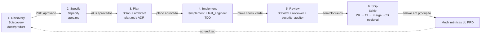

# Ways of Working — SDLC agêntico

Para uma correção local com resultado definido, comece em `$implement`. Use o pedido e o teste
de regressão como referência de `$review` e valide com `make check`.

Mudanças de contrato público, migrações e decisões arquiteturais passam por `$specify` e
`$plan` com aprovação. Comece com `$discovery` quando o problema ou o resultado de produto
precisar ser definido. O fluxo completo abaixo mostra os artefatos e as verificações de cada fase.



| Fase | Quem lidera | Artefato | Gate (Definition of Ready/Done) |
|---|---|---|---|
| Discovery | PM + Codex (`$discovery`) | `docs/product/<slug>.md` | Problema, métricas e escopo aprovados |
| Specify | PM/Tech Lead + Codex (`$specify`) | `docs/specs/NNN-*/spec.md` | Critérios de aceite testáveis aprovados |
| Plan | Tech Lead + `architect` (`$plan`) | `plan.md`, `docs/adr/*` | Plano e ADRs aprovados |
| Implement | Dev + Codex (`$implement`, `$integrate`) | código + testes | `make check` verde, cada AC com teste |
| Review | `reviewer` + `security_auditor` + humano (`$review`) | comentários no PR | Nenhum achado bloqueante |
| Ship | CI/CD (`$ship`) | merge ou implantação | CI verde e, com CD ativo, versão e readiness verificadas |

## Como usar com o Codex

```bash
codex                                   # interativo; confie no projeto para carregar .codex/config.toml
> $discovery quero permitir que lojistas importem itens via evento
> $specify docs/product/importacao-itens.md fatia 1
> $plan docs/specs/002-importacao-itens/spec.md
> $implement docs/specs/002-importacao-itens/plan.md
> $review
> $ship
codex exec "$review" --sandbox read-only   # não interativo (scripts/CI)
```

Os subagents (`.codex/agents/`) são acionados pelas skills ou explicitamente:
"use o subagent security_auditor para revisar o diff".

## Qualidade e segurança (o que `make check` e o CI garantem)

| Preocupação | Ferramenta | Onde |
|---|---|---|
| PEP 8 / PEP 257 / bugs comuns / complexidade | Ruff (lint + format) | pre-commit, CI |
| Tipagem | mypy `--strict` | pre-commit, CI |
| Arquitetura hexagonal | import-linter | pre-commit, CI |
| Testes + cobertura mínima | pytest, pytest-cov, testcontainers, respx | CI |
| Vulnerabilidades em dependências | pip-audit (lockfile completo), Dependabot | CI, semanal |
| Código inseguro | Ruff `S` (Bandit) | pre-commit, CI |
| Segredos | gitleaks | pre-commit, CI |
| Segurança dos workflows | zizmor, actions fixadas por SHA, permissões mínimas | CI |
| Imagem de container | Trivy, usuário não-root, proveniência (attestation) | CI, CD |
| Revisão | Codex review (opcional) + humano | PR |

## Entrega (CI/CD)

1. **PR** → `ci.yml`: qualidade, testes, segurança, build/scan da imagem, título Conventional Commit.
2. **Merge em `main`** → `cd.yml`: CI de novo. Com a variável de repositório `ENABLE_CD=true`, segue para imagem no GHCR (`:<sha>`) com attestation →
   `deploy.yml` em **staging** → `scripts/smoke.py` confirma que `/health/live` responde a versão
   (SHA) recém-publicada e `/health/ready` está 200 → **production** (aprovação no GitHub
   Environment) → mesma verificação → rollback automático se falhar.
3. Com a variável de repositório `ENABLE_RELEASES=true`, `release.yml` (release-please) mantém o PR de release com CHANGELOG e versionamento semântico.

As duas variáveis são independentes. Para projetos existentes que adotarem esta versão com
`copier update`, defina as opções desejadas antes do próximo merge. A falta de configuração
do destino com CD ativo falha antes do rollout.

Configuração no GitHub:
- Environments `staging` e `production` (production com *required reviewers*), cada um com a
  variável `APP_URL` e o segredo `KUBECONFIG_DATA` (base64) — ou adapte `scripts/deploy.sh` à sua
  plataforma mantendo o contrato `deploy|rollback`.
- Branch protection em `main`: PR obrigatório, checks do CI obrigatórios, squash merge.
- Opcional: segredo `OPENAI_API_KEY` + variável `CODEX_REVIEW=true` para review automático.

## Configuração do Codex pelo time

Configure aprovações, sandbox, destinos de rede permitidos e esforço de raciocínio nas políticas
do ambiente ou na configuração pessoal do Codex. Para instalar e auditar dependências, habilite
acesso aos índices aprovados pelo time. MCP é opcional. Ao integrar uma ferramenta, documente
seu propósito, os escopos mínimos, o proprietário e como provisionar credenciais nas configurações
do ambiente. Mantenha valores secretos fora do repositório.
