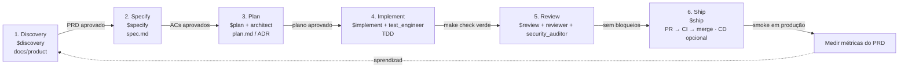

# Ways of Working — SDLC agêntico

Para uma correção local com resultado definido, comece em `$implement`. Use o pedido e o teste
de regressão como referência de `$review` e valide com `make check`.

Mudanças de contrato público, migrações e decisões arquiteturais passam por `$specify` e
`$plan` com aprovação. Comece com `$discovery` quando o problema ou o resultado de produto
precisar ser definido. O fluxo completo abaixo mostra os artefatos e as verificações de cada fase.



| Fase | Quem lidera | Artefato | Gate (Definition of Ready/Done) |
|---|---|---|---|
| Discovery | PM + Codex (`$discovery`) | `docs/product/<slug>.md` | Problema, métricas e escopo aprovados |
| Specify | PM/Tech Lead + Codex (`$specify`) | `docs/specs/NNN-*/spec.md` | Critérios de aceite testáveis aprovados |
| Plan | Tech Lead + `architect` (`$plan`) | `plan.md`, `docs/adr/*` | Plano e ADRs aprovados |
| Implement | Dev + Codex (`$implement`, `$integrate`) | código + testes | `make check` verde, cada AC com teste |
| Review | `reviewer` + `security_auditor` + humano (`$review`) | comentários no PR | Nenhum achado bloqueante |
| Ship | CI/CD (`$ship`) | merge ou implantação | CI verde e, com CD ativo, versão e readiness verificadas |

## Como usar com o Codex

```bash
codex                                   # interativo; confie no projeto para carregar .codex/config.toml
> $discovery quero permitir que lojistas importem itens via evento
> $specify docs/product/importacao-itens.md fatia 1
> $plan docs/specs/002-importacao-itens/spec.md
> $implement docs/specs/002-importacao-itens/plan.md
> $review
> $ship
codex exec "$review" --sandbox read-only   # não interativo (scripts/CI)
```

Os subagents (`.codex/agents/`) são acionados pelas skills ou explicitamente:
"use o subagent security_auditor para revisar o diff".

## Qualidade e segurança (o que `make check` e o CI garantem)

| Preocupação | Ferramenta | Onde |
|---|---|---|
| PEP 8 / PEP 257 / bugs comuns / complexidade | Ruff (lint + format) | pre-commit, CI |
| Tipagem | mypy `--strict` | pre-commit, CI |
| Arquitetura hexagonal | import-linter | pre-commit, CI |
| Testes + cobertura mínima | pytest, pytest-cov, testcontainers, respx | CI |
| Contrato HTTP = OpenAPI | Schemathesis (`tests/api/test_openapi_contract.py`) | `make test-unit`, CI |
| Invariantes do domínio | Hypothesis | `make test-unit`, CI |
| Migrações reversíveis e fiéis aos modelos | `tests/integration/test_migrations.py` (Postgres) | CI |
| Autenticação, escopos e BOLA | `require_scopes`, `TokenVerifier`, `tests/api/test_security.py` | `make test-unit`, CI |
| Exposição e configuração da API | problem+json, headers de segurança, `/docs` só local/test, limite de corpo | `make test-unit`, CI |
| DAST passivo | OWASP ZAP baseline (`.zap/rules.tsv`: FAIL bloqueia produção, WARN só relata; sem token, cobre `/health` e o 401 de `/v1`) | CD (staging, job `dast`) |
| Rate limiting | API gateway (fora da aplicação) | plataforma |
| Vulnerabilidades em dependências | pip-audit (lockfile completo), Dependabot | CI, semanal |
| Código inseguro | Ruff `S` (Bandit) | pre-commit, CI |
| Segredos | gitleaks | pre-commit, CI |
| Segurança dos workflows | zizmor, actions fixadas por SHA, permissões mínimas | CI |
| Imagem de container | Trivy, usuário não-root, proveniência (attestation) | CI, CD |
| Revisão | Codex review (opcional) + humano | PR |

## Entrega (CI/CD)

1. **PR** → `ci.yml`: qualidade, testes, segurança, build/scan da imagem, título Conventional Commit.
2. **Merge em `main`** → `cd.yml`: CI de novo → job `release` (passo 3) → com a variável de
   repositório `ENABLE_CD=true`, segue para imagem no GHCR (`:<sha>`, e `:<versão>` num commit de
   release) com attestation → `deploy.yml` em **staging** → `scripts/smoke.py` confirma que
   `/health/live` responde a versão recém-publicada (a versão semântica num commit de release, senão
   o SHA) e `/health/ready` está 200 → OWASP ZAP baseline (scan passivo) contra
   staging → **production** (aprovação no GitHub Environment) → mesma verificação → rollback
   automático se falhar. Um alerta FAIL do ZAP não faz rollback de staging (a versão já foi
   verificada); apenas impede a promoção para produção. Relatório no artefato `zap-staging-report`.
3. Com a variável de repositório `ENABLE_RELEASES=true`, o job `release` do `cd.yml`
   (release-please) roda depois do CI e mantém aberto o PR de release: a próxima versão calculada
   pelos Conventional Commits (`fix` → patch, `feat` → minor, `!` → major) em `pyproject.toml`,
   `uv.lock` e `.release-please-manifest.json`, e a nova entrada do `CHANGELOG.md`. Ninguém cria tag
   à mão: o merge desse PR cria a tag `vX.Y.Z` e a GitHub Release, e a mesma execução do `cd.yml`
   implanta essa versão (com `ENABLE_CD=true`). Os merges entre releases são implantados pelo SHA e
   se acumulam no PR de release.

As duas variáveis são independentes. Com `ENABLE_RELEASES=true`, habilite em **Settings → Actions →
General** a opção **Allow GitHub Actions to create and approve pull requests**; sem ela o job
`release` falha e, com CD ativo, bloqueia o deploy. O PR de release é aberto com `GITHUB_TOKEN`, que
não dispara workflows de `pull_request`: se a proteção de branch exigir o CI nele, feche e reabra o
PR para rodar as verificações. Para projetos existentes que adotarem esta versão com
`copier update`, defina as opções desejadas antes do próximo merge. A falta de configuração
do destino com CD ativo falha antes do rollout.

Configuração no GitHub:
- Environments `staging` e `production` (production com *required reviewers*), cada um com a
  variável `APP_URL` e o segredo `KUBECONFIG_DATA` (base64) — ou adapte `scripts/deploy.sh` à sua
  plataforma mantendo o contrato `deploy|rollback`.
- Autenticação por ambiente: o provedor OIDC de cada ambiente vira variáveis (não são segredos)
  do GitHub Environment e da plataforma onde o container roda. O `scripts/deploy.sh` padrão só
  troca a imagem, então a configuração de runtime precisa existir na plataforma (ex.: ConfigMap).

  | Variável | `staging` / `production` |
  |---|---|
  | `APP_ENV` | `staging` / `production` |
  | `APP_AUTH_JWKS_URL` | URL HTTPS do JWKS do provedor |
  | `APP_AUTH_ISSUER` | `iss` exato emitido pelo provedor |
  | `APP_AUTH_AUDIENCE` | identificador da API no provedor |
  | `APP_AUTH_ALGORITHMS` | opcional (padrão `RS256`) |
  | `APP_MAX_BODY_BYTES` | opcional (padrão 1 MiB) |
  | `APP_AUTH_DEV_SECRET` | nunca definir: a aplicação não sobe |

  Sem JWKS, emissor ou audiência a aplicação falha na inicialização e o deploy faz rollback.
  Rate limiting e cotas ficam no API gateway na frente do serviço.
- Branch protection em `main`: PR obrigatório, checks do CI obrigatórios, squash merge.
- Opcional, review automático no PR: com Codex, segredo `OPENAI_API_KEY` + variável `CODEX_REVIEW=true`;
  com Claude Code, segredo `ANTHROPIC_API_KEY` + variável `CLAUDE_REVIEW=true`. O Copilot tem code review nativo.

## Configuração do Codex pelo time

Configure aprovações, sandbox, destinos de rede permitidos e esforço de raciocínio nas políticas
do ambiente ou na configuração pessoal do Codex. Para instalar e auditar dependências, habilite
acesso aos índices aprovados pelo time. MCP é opcional. Ao integrar uma ferramenta, documente
seu propósito, os escopos mínimos, o proprietário e como provisionar credenciais nas configurações
do ambiente. Mantenha valores secretos fora do repositório.
